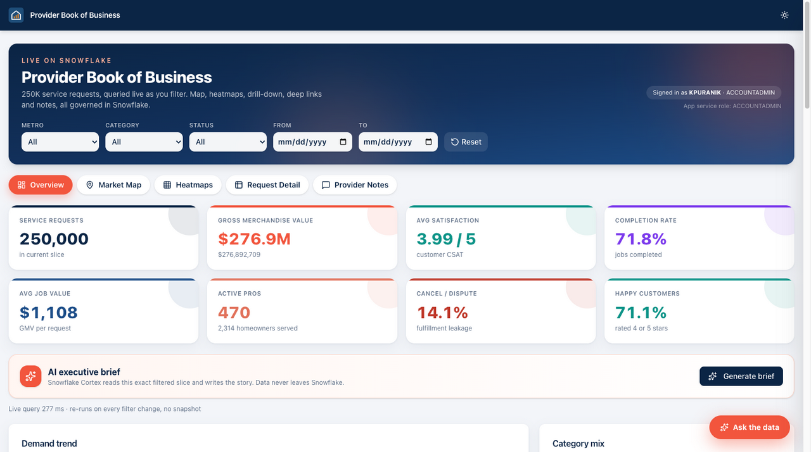
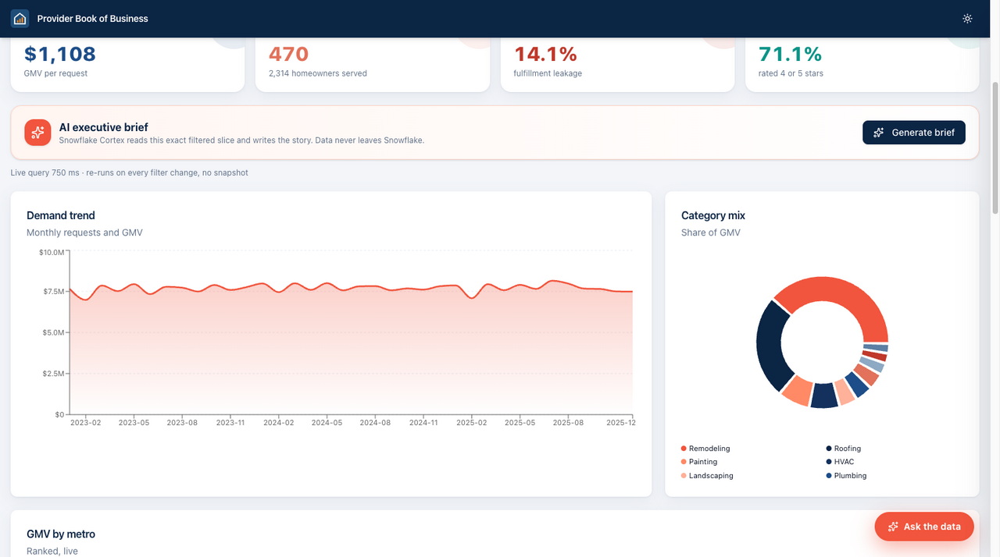
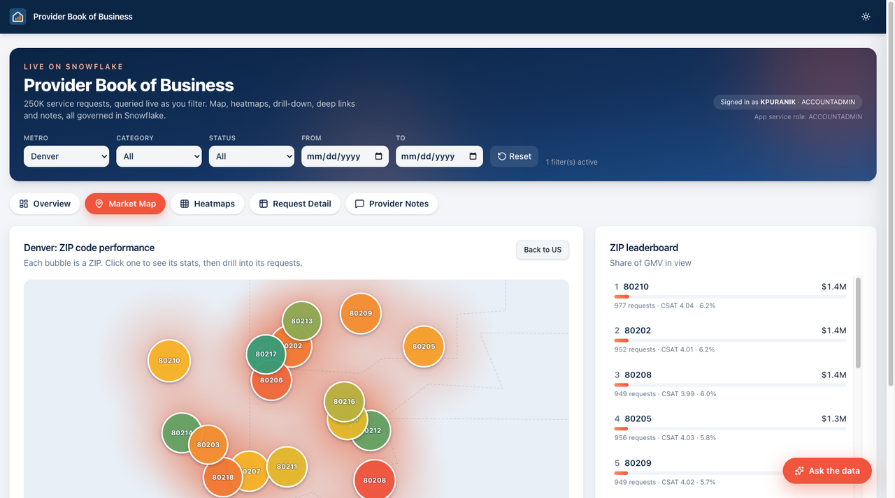
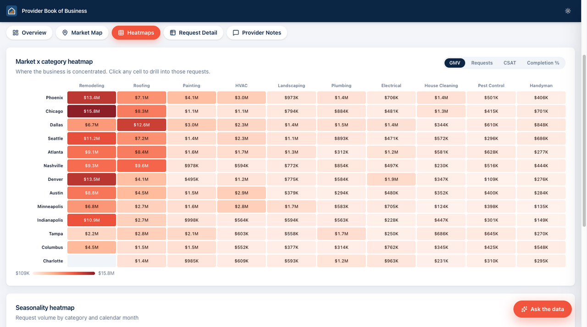
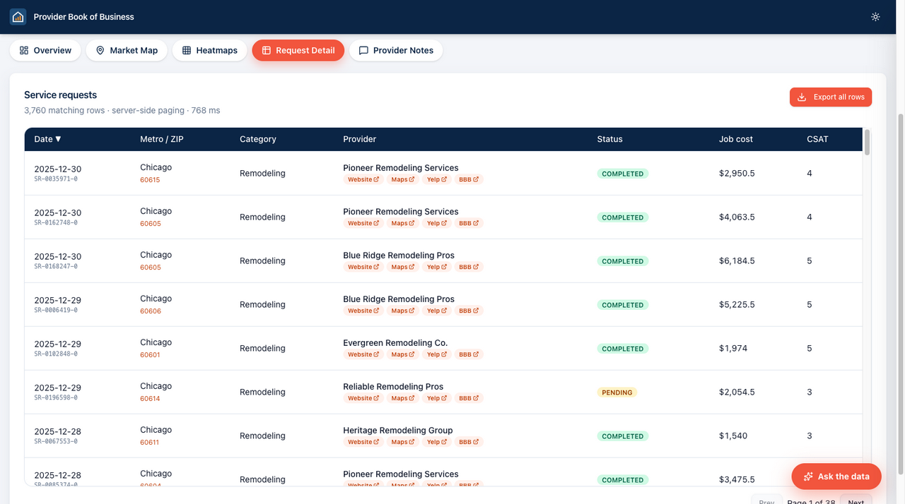
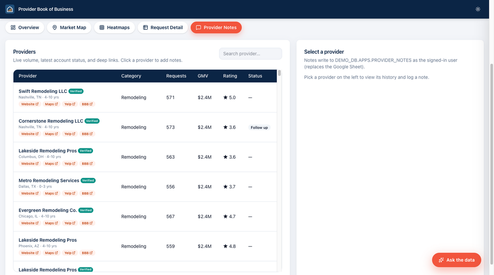

# Provider Book of Business (Snowflake App Runtime demo)

An interactive reporting app for a home services marketplace, built with Next.js by **Snowflake Cortex Code (CoCo)** and deployed on **Snowflake App Runtime**. All data is synthetic.

## Features
- **Overview:** live KPIs (requests, GMV, CSAT, completion rate, active pros) that update as you filter.
- **Market Map and Heatmaps:** ZIP-level map and category by month heatmaps.
- **Request Detail:** drill down to individual requests and providers.
- **Provider Notes:** account managers write notes back to a Snowflake table.
- **Ask the data:** a chat drawer backed by a Cortex Agent (semantic view plus Cortex Search over feedback).
- **Deep links:** the URL tracks the filters and tab, e.g. `?metro=Denver&category=HVAC&tab=map`.
- **Caller's rights:** queries run as the signed-in user (`executeAsCaller: true`), so each person sees only what their role allows.

## Screenshots

**Overview:** live KPIs for the current filter slice


**Charts:** demand trend and category mix


**Market Map:** ZIP-level performance, here filtered to Denver


**Heatmaps:** market by category GMV


**Request Detail:** server-side paged requests, here Chicago Remodeling


**Provider Notes:** provider list with notes written back to Snowflake


## Prerequisites
- A Snowflake account with App Runtime and Cortex (Agents, Analyst, Search) available.
- [Snowflake CLI](https://docs.snowflake.com/en/developer-guide/snowflake-cli/index) with a default connection configured.
- Node.js 20+.

## Setup
Run these in order. The scripts use `ACCOUNTADMIN`. If another role will own the app, replace it in `sql/setup.sql`.

```bash
# 1. Create DEMO_DB, the BOB_DEMO_WH warehouse and ~250K rows of synthetic data
snow sql -f sql/generate_data.sql

# 2. Create the Cortex Search service, semantic view, Cortex Agent and caller grants
snow sql -f sql/setup.sql

# 3. Build and deploy the app
npm install
npm run build
snow app deploy
```

The deploy prints the app URL. To grant other users access, see the App Runtime docs on sharing applications.

## What the demo creates
| Type | Object | Created by | Purpose |
|---|---|---|---|
| Database / schemas | `DEMO_DB`, `DEMO_DB.APPS`, `DEMO_DB.ANALYTICS` | `generate_data.sql` | Holds all demo objects |
| Warehouse | `BOB_DEMO_WH` (Medium) | `generate_data.sql` | Runs the app's and agent's queries |
| Table | `DEMO_DB.APPS.SERVICE_REQUESTS_LARGE` | `generate_data.sql` | 250K synthetic service requests |
| Table | `DEMO_DB.APPS.DIM_PROVIDER_DEMO` | `generate_data.sql` | 470 service providers |
| Table | `DEMO_DB.APPS.DIM_ZIP` | `generate_data.sql` | Synthetic ZIP centroids for the map |
| Table | `DEMO_DB.APPS.PROVIDER_NOTES` | `generate_data.sql` | Notes written back from the app |
| Table | `DEMO_DB.ANALYTICS.CUSTOMER_FEEDBACK` | `generate_data.sql` | Feedback text for search |
| Cortex Search service | `DEMO_DB.ANALYTICS.FEEDBACK_SEARCH` | `setup.sql` | Searches customer feedback for the chat |
| Semantic view | `DEMO_DB.APPS.BOB_SV` | `setup.sql` | Metric definitions (GMV, CSAT, completion %) used by Cortex Analyst |
| Cortex Agent | `SNOWFLAKE_INTELLIGENCE.AGENTS.BOB_AGENT` | `setup.sql` | Powers the "Ask the data" chat (semantic view + search tools) |
| Caller grants | `GRANT CALLER ...` on the objects above | `setup.sql` | Lets the app run queries as the signed-in user |
| App Runtime application service | `DEMO_DB.APPS.BOB_APP` | `snow app deploy` | The Next.js app, hosted and served by Snowflake |

## Local development
```bash
npm install
npm run dev
```
The app uses your default Snowflake CLI connection. Set `SNOWFLAKE_CONNECTION_NAME=myconn` to use a different one. The chat drawer needs the deployed app's tokens for caller's rights. Locally it falls back to your own connection.

## Operations
```sql
-- Pause / resume
ALTER APPLICATION SERVICE DEMO_DB.APPS.BOB_APP SUSPEND;
ALTER APPLICATION SERVICE DEMO_DB.APPS.BOB_APP RESUME;
-- Roll back to a previous deploy
ALTER APPLICATION SERVICE DEMO_DB.APPS.BOB_APP UPGRADE TO VERSION VERSION$1;
```
Set `auto_suspend_secs` (minimum 300) and `auto_resume` in `app.yml` so they persist across deploys.

## Clean up
```sql
DROP APPLICATION SERVICE IF EXISTS DEMO_DB.APPS.BOB_APP;
DROP AGENT IF EXISTS SNOWFLAKE_INTELLIGENCE.AGENTS.BOB_AGENT;
DROP DATABASE IF EXISTS DEMO_DB;
DROP WAREHOUSE IF EXISTS BOB_DEMO_WH;
```
